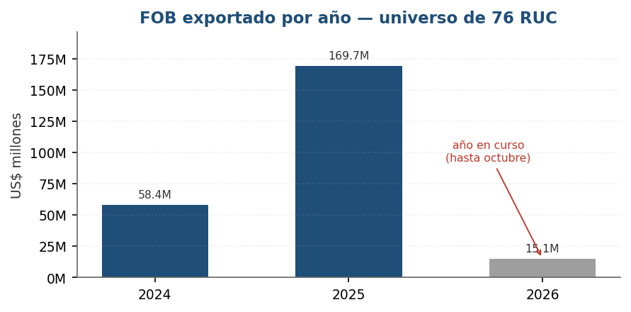
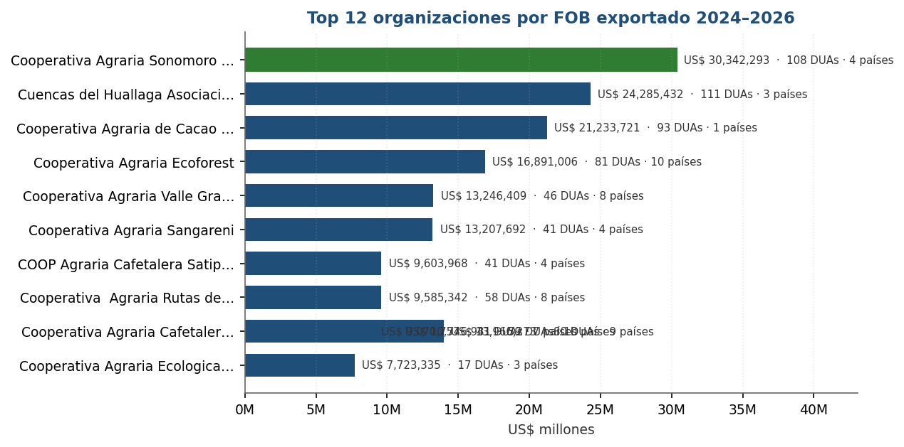
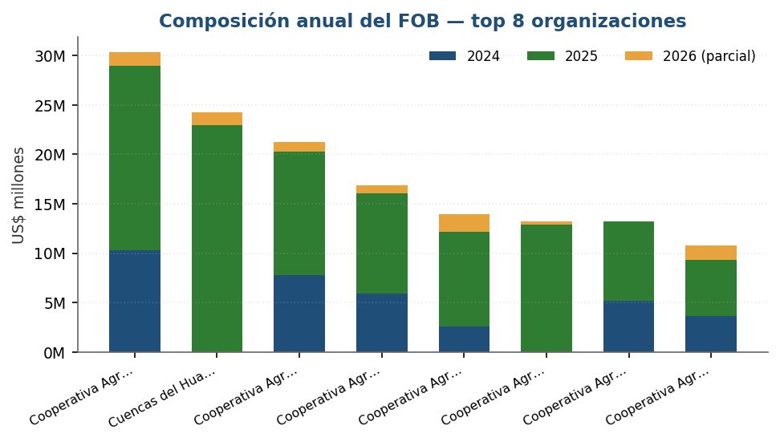
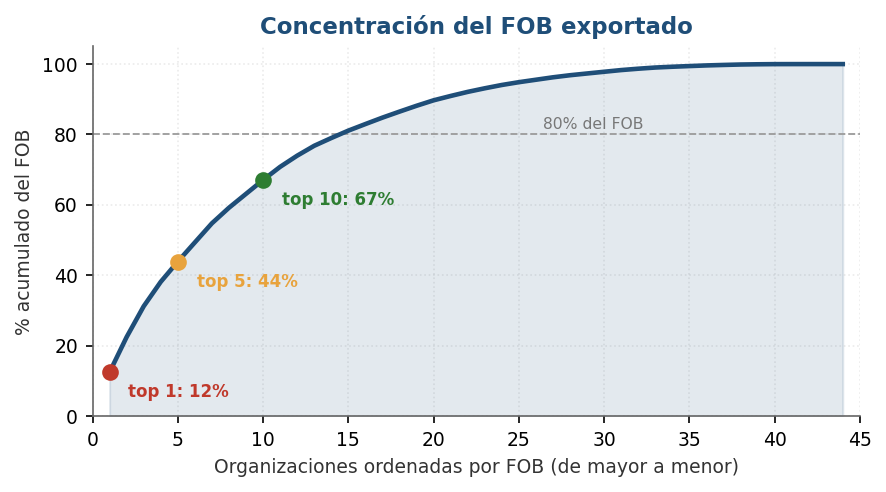
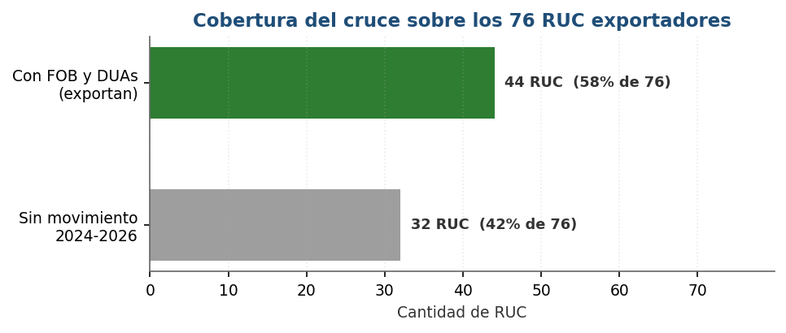

# Cruce de DUAs y FOB en dólares

## Informe de movimientos de exportación 2024 – 2026

**Universo:** 76 organizaciones cafetaleras y cacaoteras clasificadas como EXPORTADOR o IMPORTADOR/EXPORTADOR que integran la base de 174.  
**Fecha de corte:** 11 de octubre de 2026 · **2026 parcial** (hasta octubre).

---

## 1. Resumen ejecutivo

| Indicador | Valor |
|---|---|
| Organizaciones del universo | 76 |
| **Con exportación confirmada (FOB y DUAs)** | **44 (58%)** |
| Sin movimiento en régimen 40 durante 2024-2026 | 32 (42%) |
| **FOB exportado total** | **US$ 243,192,124** |
| **DUAs totales** | **1,141** |
| Operaciones FOB | 686 |
| Ticket promedio | US$ 213,139 por DUA |
| Países destino | 25 |
| Canal VERDE / ROJO | 1,135 / 6 |
| Concentración: top 10 de 76 | 67% del FOB |

**Tres conclusiones de fondo:**

1. **La exportación está muy concentrada.** Las 10 organizaciones más grandes explican el 67% del FOB del universo; las 15 primeras, el 81%. Trabajar el círculo chico mueve la mayoría del dinero.
2. **Ser exportador registrado no equivale a exportar.** 32 de 76 RUC figuran como exportadores en su ficha SUNAT pero no registran movimiento en régimen 40 durante 2024-2026.
3. **2025 es el año récord**, con US$ 169,652,632, el 70% del FOB del período; 2024 aportó US$ 58,417,684 y 2026 (parcial) US$ 15,121,808.

## 2. Metodología y fuentes

### Fuentes

| Dato | Fuente | Cobertura |
|---|---|---|
| FOB en dólares | `BASE CONSOLIDADA.xlsx` → `HECHO_EXPORTACION` (SUNAT – Aduanas, exportaciones) | 2024, 2025 y 2026 |
| DUAs, fecha de embarque y canal | `ficharucsunat/dua_canal_final.csv` (`accion=buscarListadoDuas` de ADUANET) | 2024, 2025 y 2026 |
| Verificación en vivo | `_verif_dua_links.csv`: 699 enlaces consultados, 573 con datos | 2024-2026 |

### Clave de cruce

El cruce se hace por **RUC + año + mes + aduana + país**. El agente de aduana **no** entra en la clave por un defecto de la fuente, documentado en la sección 7.

Con esa clave coinciden **917 combinaciones** y quedan **0 combinaciones con DUAs sin FOB**, sobre un FOB cruzado de US$ 291,8 millones de los US$ 292,7 millones totales de la fuente.

### Advertencia sobre el ticket promedio

Una misma combinación puede tener más de una DUA (embarques distintos con los mismos códigos). El FOB de la combinación se reparte entre esas DUAs, por lo que el ticket promedio es *FOB de la combinación ÷ número de DUAs*, **no** un dato propio de la DUA individual. Para el FOB por DUA hace falta el detalle `SgCDUI2`, que pide captcha.

### Cuadre

| Verificación | Resultado |
|---|---|
| FOB total igual en las 4 hojas del libro | US$ 243,192,124 ✓ |
| DUAs iguales en las 3 hojas | 1,141 ✓ |
| 2024 + 2025 + 2026 = total | ✓ |
| Operaciones FOB por año = total | 686 ✓ |

## 3. FOB exportado por año

| Año | RUC con FOB | RUC con DUAs | Operaciones FOB | DUAs | FOB USD | Ticket promedio | Países |
|---|---|---|---|---|---|---|---|
| 2024 | 25 | 25 | 215 | 301 | US$ 58,417,684 | US$ 194,079 | 23 |
| 2025 | 41 | 41 | 395 | 734 | US$ 169,652,632 | US$ 231,134 | 25 |
| 2026 | 30 | 30 | 76 | 106 | US$ 15,121,808 | US$ 142,659 | 18 |
| **Total** | **44** | **44** | **686** | **1,141** | **US$ 243,192,124** | **US$ 213,139** | **25** |

*2026 está parcial: llega hasta octubre, por lo que su FOB no es comparable con un año completo. El ticket promedio de 2026 (US$ 142,659) es además el más alto de los tres, señal de que los embarques recientes son de mayor valor unitario.*

## 4. Las organizaciones que más exportan

| # | RUC | Organización | FOB 2024 | FOB 2025 | FOB 2026 | FOB total | DUAs | Países |
|---|---|---|---|---|---|---|---|---|
| 1 | 20486973219 | Cooperativa Agraria Sonomoro del VRAEM … | US$ 10,261,244 | US$ 18,675,677 | US$ 1,405,372 | **US$ 30,342,293** | 108 | 4 |
| 2 | 20542289024 | Cuencas del Huallaga Asociacion de Prod… | US$ 0 | US$ 22,972,813 | US$ 1,312,619 | **US$ 24,285,432** | 111 | 3 |
| 3 | 20600390911 | Cooperativa Agraria de Cacao Aromatico … | US$ 7,796,177 | US$ 12,445,021 | US$ 992,523 | **US$ 21,233,721** | 93 | 1 |
| 4 | 20542380455 | Cooperativa Agraria Ecoforest | US$ 5,929,450 | US$ 10,148,850 | US$ 812,707 | **US$ 16,891,006** | 81 | 10 |
| 5 | 20601958911 | Cooperativa Agraria Cafetalera Laguna d… | US$ 2,581,164 | US$ 9,537,123 | US$ 1,847,987 | **US$ 13,966,273** | 80 | 9 |
| 6 | 20542209951 | Cooperativa Agraria Valle Grande | US$ 0 | US$ 12,852,633 | US$ 393,775 | **US$ 13,246,409** | 46 | 8 |
| 7 | 20486255090 | Cooperativa Agraria Sangareni | US$ 5,217,096 | US$ 7,990,596 | US$ 0 | **US$ 13,207,692** | 41 | 4 |
| 8 | 20527565376 | Cooperativa Agraria Cafetalera Valle de… | US$ 3,608,738 | US$ 5,685,066 | US$ 1,453,128 | **US$ 10,746,931** | 59 | 10 |
| 9 | 20129529530 | COOP Agraria Cafetalera Satipo LTDA | US$ 2,526,946 | US$ 6,815,862 | US$ 261,160 | **US$ 9,603,968** | 41 | 4 |
| 10 | 20570706927 | Cooperativa  Agraria Rutas del Inca | US$ 3,163,528 | US$ 5,687,020 | US$ 734,794 | **US$ 9,585,342** | 58 | 8 |
| 11 | 20170142773 | Cooperativa Agraria Cafetalera Bagua Gr… | US$ 2,528,982 | US$ 6,139,391 | US$ 402,385 | **US$ 9,070,757** | 41 | 7 |
| 12 | 20611935243 | Cooperativa Agraria Ecologica Caniari A… | US$ 0 | US$ 7,723,335 | US$ 0 | **US$ 7,723,335** | 17 | 3 |
| | | **Top 12** | US$ 43,613,323 | US$ 126,673,386 | US$ 9,616,450 | **US$ 179,903,159** | 776 | |

**Lecturas del cuadro:**

- **Tres organizaciones concentran el 31% del FOB**: Sonomoro del VRAEM (US$ 30,342,293), Cuencas del Huallaga (US$ 24,285,432) y Cacao Aromático Colpa de Loros (US$ 21,233,721).
- **Colpa de Loros exporta a un solo país** (Francia, vía Kaoka) y aun así es la tercera: tiene una alianza comercial exclusiva que sustituye la diversificación.
- **Ecoforest y Valle de Incahuasi son las más diversificadas** del top: 10 países cada una.
- **Valle Grande, Cuencas del Huallaga y Caecam solo tienen FOB de 2025 en adelante**: son organizaciones de arranque reciente o que consolidaron su exportación ese año.
- **Sangareni no registra FOB en 2026**, con US$ 13,2 millones acumulados de 2024-2025: es la única del top con un año completo en cero. Vale verificar si es discontinuidad o cambio de razón social.

## 5. Concentración del FOB

| Ordenamiento | FOB acumulado | % del universo |
|---|---|---|
| Top 1 | US$ 30,342,293 | 12% |
| Top 3 | US$ 75,861,446 | 31% |
| Top 5 | US$ 106,718,726 | 44% |
| Top 10 | US$ 163,109,067 | 67% |
| Top 15 | US$ 197,202,292 | 81% |
| Top 20 | US$ 218,149,690 | 90% |
| **44 organizaciones con FOB** | **US$ 243,192,124** | **100%** |

El 67% del FOB sale de las 10 primeras organizaciones. Dicho de otro modo: **con atender 10 de 76 RUC se cubre dos tercios del movimiento exportador** del universo.

## 6. Cobertura: los 32 RUC sin movimiento

De los 76 RUC que la ficha SUNAT clasifica como exportadores, **32 no registran FOB ni DUAs en régimen 40 durante 2024-2026**.

| RUC | Razón social |
|---|---|
| 20129156083 | COOP Agraria Cafet Valle Rio Apurimac |
| 20132517119 | Cooperativa Agraria Cafetalera Mateo Pumacahua LTDA N° 185 |
| 20140292657 | Cooperativa Agraria Cafetalera Ccochapampa LTDA. |
| 20352417018 | Cooperativa Agraria de Cacaoteros Tecnificados de Padre Abad |
| 20352423921 | Cooperativa Agraria Cafetalera Divisoria LTDA |
| 20393593670 | Comite Central Con Desarrollo al Futuro de Curimana |
| 20393692228 | Cooperativa Agraria Cacaotera San Alejandro LTDA |
| 20393816211 | Cooperativa Agraria San Juan Bautista |
| 20450189201 | Cooperativa de Servicios Multiples Frutos de Selva |
| 20450207544 | Cooperativa Agraria Uchiza LTDA |
| 20450242021 | Cooperativa de Servicios Multiples Capema |
| 20479622699 | Cooperativa Agraria Juan Marco el Palto |
| 20480762895 | Asociacion de Productores Agropecuarios la Flor de Cafe |
| 20485945815 | Cooperativa Agraria Cafetalera Ecologico Alto Palomar |
| 20486094657 | Asociacion de Productores de Cafes Especiales Mountain Coffe |
| 20486668335 | Cooperativa Agroindustrial Sonomoro LTDA |
| 20493934822 | Cooperativa Agraria Nuevo Amanecer LTDA. |
| 20531405723 | Cooperativa de Servicios Multiples Adisa Naranjos |
| 20542825163 | Cooperativa Agraria Cacao Fino Agrobosque |
| 20561140091 | Cooperativa Agraria Ecologica Cafetalera de Lonya Grande |
| 20564032485 | Asociacion de Productores Ecologicos de Cacao Medio Urubamba … |
| 20568567731 | Cooperativa Agraria Villa Rica Golden Coffee LTDA. |
| 20568962282 | Asociación de Productores Centro Coffee |
| 20573057385 | Cooperativa Agraria Paraiso |
| 20600146689 | Cooperativa Agraria de Servicios Agricolas Tambopata Candamo |
| 20600200756 | Cooperativa Agraria Cafetalera Montaña Azul LTDA. - Coopacma |
| 20601537771 | Asociacion de Productores Sostenibles el Ayni |
| 20601919657 | Cooperativa Agraria Innovacion  Cacao y Cafe del VRAEM |
| 20601939402 | Cooperativa Agraria Ashaninka Kemito Sankori LTDA |
| 20602161081 | Aprovaperu |
| 20602488927 | Cooperativa Agraria Ecologico Rosas Pampa LTDA - Caeco Rosas … |
| 20610739491 | Asociacion de Productores Agropecuarios Don Andres-Amazonas |

**Interpretación.** No significa necesariamente que no exporten. Las explicaciones posibles, en orden de frecuencia para este tipo de organizaciones, son:

1. **Venta mediante comercializadora:** la cooperativa vende su café o cacao a un intermediario o exportador, y la DUA sale a nombre del comprador. Es el caso más común en organizaciones chicas sin plataforma de exportación propia.
2. **Exportación bajo otro régimen distinto al 40** (por ejemplo, regímenes temporales o de draw-back), que no quedan en esta consulta.
3. **Registro SUNAT vigente pero operación real suspendida**, como la Cooperativa Agraria de Cacaoteros Tecnificados de Padre Abad (RUC 20352417018), que figura en *suspensión temporal*.

En los tres casos la conclusión práctica es la misma: **estas organizaciones no son exportadoras directas y no deberían tratarse como tales** en un análisis de cadena de valor sin verificarlo una por una.

## 7. Hallazgo de calidad de datos: el agente de aduana en 2024

Durante el cruce se detectó un defecto de la fuente que conviene dejar documentado porque afecta cualquier análisis que cruce estas dos tablas por agente.

| Año | Filas en `HECHO_EXPORTACION` | `agente_codigo = 0` (vacío) | Agentes con dato |
|---|---|---|---|
| 2024 | 278 | 278 | 0 |
| 2025 | 566 | 0 | 27 |
| 2026 | 114 | 0 | 18 |

**Consecuencia.** Las **278 filas de 2024** —todas— llegaron sin código de agente. Al cruzar por RUC + año + mes + aduana + **agente** + país, el resultado era engañoso: 271 combinaciones con FOB y sin DUAs, y otras 271 al revés, con las casillas de FOB en cero. Un análisis que mirara solo esas cifras concluiría falsamente que 2024 no tuvo DUAs.

**Solución aplicada.** Se quitó el agente de la clave de cruce y se pasó a **RUC + año + mes + aduana + país**. El agente se conserva como columna informativa, tomado de la tabla de DUAs cuando existe y de la de FOB cuando no. Con esa clave:

- Coinciden **917 combinaciones**.
- Quedan **0 combinaciones con DUAs y sin FOB** (antes 271).
- El FOB que cruza con DUAs sube a **US$ 291,8 millones de US$ 292,7 millones**.
- La hoja de detalle por combinación pasa de 888 a **655 filas**, todas con FOB real.

**Recomendación.** Corregir el ingreso de 2024 en `HECHO_EXPORTACION` completando el `agente_codigo` desde `dua_canal_final.csv`, que sí lo tiene. Con ese arreglo el cruce por agente vuelve a ser válido y se gana la dimensión del agente en el análisis.

## 8. Canales de control

De las 1,141 DUAs del universo, **1,135 salieron por canal VERDE y 6 por canal ROJO** (0.53%).

| RUC | Organización | DUAs rojas | DUAs totales | FOB total |
|---|---|---|---|---|
| 20612331821 | Asociación de Mujeres las Flores de Luya | 2 | 2 | US$ 300,233 |
| 20479595276 | Cooperativa Agraria Cafetalera Casil LTDA. | 1 | 24 | US$ 4,538,579 |
| 20542264544 | Cooperativa Agraria Valle del Biavo LTDA | 1 | 6 | US$ 1,187,600 |
| 20603320621 | Cooperativa Agraria Cafetalera Alta Montaña | 1 | 1 | US$ 161,000 |
| 20531441797 | Cooperativa Agraria Allima Cacao LTDA. | 1 | 1 | US$ 1,984 |

El canal rojo implica inspección física de la mercancía. Son 6 operaciones de 5 organizaciones, así que no hay un patrón sistémico, pero conviene revisarlas: una DUA roja repetida en la misma organización suele indicar un problema de documentación o de clasificación arancelaria. **Allima Cacao** tiene una DUA roja sobre un FOB de apenas US$ 1 984, proporción que no se justifica por el volumen y sugiere un problema de papeles más que de mercancía.

## 9. Anexo: las 44 organizaciones con exportación confirmada

| RUC | Organización | FOB 2024 | FOB 2025 | FOB 2026 | FOB total | DUAs | Ticket prom. | Países | Aduanas |
|---|---|---|---|---|---|---|---|---|---|
| 20486973219 | Cooperativa Agraria Sonomoro del … | US$ 10,261,244 | US$ 18,675,677 | US$ 1,405,372 | US$ 30,342,293 | 108 | US$ 280,947 | BE, CA, IT, NL | 118 |
| 20542289024 | Cuencas del Huallaga Asociacion d… | US$ 0 | US$ 22,972,813 | US$ 1,312,619 | US$ 24,285,432 | 111 | US$ 218,788 | BE, IT, NL | 118, 235 |
| 20600390911 | Cooperativa Agraria de Cacao Arom… | US$ 7,796,177 | US$ 12,445,021 | US$ 992,523 | US$ 21,233,721 | 93 | US$ 228,320 | BE | 118 |
| 20542380455 | Cooperativa Agraria Ecoforest | US$ 5,929,450 | US$ 10,148,850 | US$ 812,707 | US$ 16,891,006 | 81 | US$ 208,531 | BE, CA, DE, DK, ES, FR, GB, IT, SE, US | 46 |
| 20601958911 | Cooperativa Agraria Cafetalera La… | US$ 2,581,164 | US$ 9,537,123 | US$ 1,847,987 | US$ 13,966,273 | 80 | US$ 174,578 | AU, BE, CA, DE, IT, KR, NZ, SE, US | 46 |
| 20542209951 | Cooperativa Agraria Valle Grande | US$ 0 | US$ 12,852,633 | US$ 393,775 | US$ 13,246,409 | 46 | US$ 287,965 | BE, CA, DE, FR, GB, NL, SE, US | 46 |
| 20486255090 | Cooperativa Agraria Sangareni | US$ 5,217,096 | US$ 7,990,596 | US$ 0 | US$ 13,207,692 | 41 | US$ 322,139 | CA, DE, GB, US | 118 |
| 20527565376 | Cooperativa Agraria Cafetalera Va… | US$ 3,608,738 | US$ 5,685,066 | US$ 1,453,128 | US$ 10,746,931 | 59 | US$ 182,151 | BE, CA, CL, DE, DK, FR, JP, SE, TW, US | 118, 235 |
| 20129529530 | COOP Agraria Cafetalera Satipo LT… | US$ 2,526,946 | US$ 6,815,862 | US$ 261,160 | US$ 9,603,968 | 41 | US$ 234,243 | BE, DE, NL, US | 118 |
| 20570706927 | Cooperativa  Agraria Rutas del In… | US$ 3,163,528 | US$ 5,687,020 | US$ 734,794 | US$ 9,585,342 | 58 | US$ 165,265 | BE, DE, HK, JP, MX, NL, SA, US | 118, 46 |
| 20170142773 | Cooperativa Agraria Cafetalera Ba… | US$ 2,528,982 | US$ 6,139,391 | US$ 402,385 | US$ 9,070,757 | 41 | US$ 221,238 | BE, CA, DE, GB, IE, TR, US | 46 |
| 20611935243 | Cooperativa Agraria Ecologica Can… | US$ 0 | US$ 7,723,335 | US$ 0 | US$ 7,723,335 | 17 | US$ 454,314 | IT, NL, US | 118 |
| 20602650643 | Asociación Agroexportadora de la … | US$ 0 | US$ 6,702,453 | US$ 134,408 | US$ 6,836,861 | 36 | US$ 189,913 | BE, CA, DE, DK, GB, IE, MX, NL, NO, SE, US | 46 |
| 20568194951 | Asociacion de Productores Agrosos… | US$ 0 | US$ 5,121,641 | US$ 233,385 | US$ 5,355,025 | 27 | US$ 198,334 | CA, DE, IT, US | 118 |
| 20118578415 | Cent.de Coop.agr. Caf.valles Sand… | US$ 1,774,443 | US$ 2,104,744 | US$ 1,228,060 | US$ 5,107,247 | 38 | US$ 134,401 | AU, BE, CA, DE, GB, IE, US | 118 |
| 20479595276 | Cooperativa Agraria Cafetalera Ca… | US$ 1,282,513 | US$ 3,256,066 | US$ 0 | US$ 4,538,579 | 24 | US$ 189,107 | BE, CA, DE, JP, KR, PT, SE, US | 118, 46 |
| 20136201213 | Central de Cooperativas Agrarias … | US$ 1,446,154 | US$ 2,833,351 | US$ 166,106 | US$ 4,445,612 | 33 | US$ 134,716 | CA, DE, FR, JP, US | 118 |
| 20600263286 | Asociación de Productores Selva N… | US$ 0 | US$ 4,154,568 | US$ 0 | US$ 4,154,568 | 25 | US$ 166,183 | AU, BE, CO, DE, DK, SE, US | 46 |
| 20143692010 | Cooperativa Agraria el Quinacho L… | US$ 1,652,332 | US$ 2,269,170 | US$ 109,193 | US$ 4,030,695 | 14 | US$ 287,907 | BE, IT, NL | 118 |
| 20572190251 | Central de Cooperativas Agrarias … | US$ 1,525,540 | US$ 2,037,198 | US$ 215,206 | US$ 3,777,945 | 14 | US$ 269,853 | EE, ES, ID, IT, NL, PH, US | 118 |
| 20607536016 | Cooperativa Agraria Coopagro LTDA… | US$ 1,022,648 | US$ 1,979,571 | US$ 0 | US$ 3,002,219 | 19 | US$ 158,012 | BE, CA, DE, FR, GP, MX, SE | 46 |
| 20542257416 | Empresa Industrial Oro Verde Soci… | US$ 0 | US$ 2,558,050 | US$ 268,025 | US$ 2,826,075 | 12 | US$ 235,506 | EE, ES, NL, US | 118 |
| 20132509795 | Cooperativa Agraria Cafetalera Jo… | US$ 1,437,984 | US$ 1,039,099 | US$ 0 | US$ 2,477,084 | 14 | US$ 176,935 | AU, DE, GB, NL, TR | 118 |
| 20487242994 | Cooperativa Agraria Ecologica Cac… | US$ 818,490 | US$ 1,270,981 | US$ 201,507 | US$ 2,290,979 | 10 | US$ 229,098 | IT, NL | 118 |
| 20452774705 | Cooperativa Agraria Cacao Vrae | US$ 0 | US$ 1,102,151 | US$ 829,301 | US$ 1,931,453 | 7 | US$ 275,922 | BE, DE, IT, NL, US | 118 |
| 20132509876 | Cooperativa Agraria Cafetalera Ma… | US$ 673,071 | US$ 406,700 | US$ 610,050 | US$ 1,689,820 | 5 | US$ 337,964 | JP | 118 |
| 20480458550 | Cooperativa Agraria APROCAM | US$ 496,931 | US$ 1,053,705 | US$ 133,794 | US$ 1,684,430 | 14 | US$ 120,316 | BE, IT | 46 |
| 20568071281 | Cooperativa Agraria Cafetalera Ce… | US$ 992,409 | US$ 166,038 | US$ 277,276 | US$ 1,435,724 | 10 | US$ 143,572 | BE, DE, DK | 118 |
| 20603820691 | Cooperativa Agraria de Servicios … | US$ 0 | US$ 896,995 | US$ 304,132 | US$ 1,201,127 | 8 | US$ 150,141 | BE, DE, NL, US | 118, 46 |
| 20542264544 | Cooperativa Agraria Valle del Bia… | US$ 0 | US$ 1,034,238 | US$ 153,363 | US$ 1,187,600 | 6 | US$ 197,933 | BE | 46 |
| 20479917141 | Cooperativa Agraria Central de Pr… | US$ 797,333 | US$ 377,882 | US$ 0 | US$ 1,175,215 | 7 | US$ 167,888 | IT, US | 46 |
| 20606451122 | Asociación de Productores Cerro B… | US$ 0 | US$ 864,648 | US$ 76,135 | US$ 940,783 | 7 | US$ 134,398 | DK, HK, NO, US | 118, 46 |
| 20484163902 | Cooperativa Agraria Approcap LTDA | US$ 232,600 | US$ 447,400 | US$ 137,000 | US$ 817,000 | 6 | US$ 136,167 | ES | 46 |
| 20604151954 | Cooperativa Agraria de Servicios … | US$ 207,489 | US$ 273,433 | US$ 63,040 | US$ 543,961 | 5 | US$ 108,792 | BE, FR | 118 |
| 20600785541 | Asociacion de Productores Cafetal… | US$ 0 | US$ 284,507 | US$ 179,922 | US$ 464,429 | 3 | US$ 154,810 | US | 46 |
| 20601558204 | Cooperativa Agraria Cafetalera Oc… | US$ 442,439 | US$ 0 | US$ 0 | US$ 442,439 | 4 | US$ 110,610 | US | 46 |
| 20603862369 | Cooperativa Agraria Tropicals Pro… | US$ 0 | US$ 151,198 | US$ 181,357 | US$ 332,555 | 2 | US$ 166,278 | DK | 118 |
| 20612331821 | Asociación de Mujeres las Flores … | US$ 0 | US$ 300,233 | US$ 0 | US$ 300,233 | 2 | US$ 150,117 | US | 46 |
| 20603320621 | Cooperativa Agraria Cafetalera Al… | US$ 0 | US$ 161,000 | US$ 0 | US$ 161,000 | 1 | US$ 161,000 | HR | 46 |
| 20525969551 | Cooperativa Agraria de Productore… | US$ 0 | US$ 105,840 | US$ 0 | US$ 105,840 | 7 | US$ 15,120 | BE, NL | 46 |
| 20608478311 | Cooperativa Agraria Yakatheo del … | US$ 0 | US$ 19,112 | US$ 0 | US$ 19,112 | 1 | US$ 19,112 | CH | 235 |
| 20604309728 | Asociacion de Productores Cafetal… | US$ 0 | US$ 7,275 | US$ 0 | US$ 7,275 | 1 | US$ 7,275 | TW | 46 |
| 20608294512 | Cooperativa Agraria Kuri Valle de… | US$ 0 | US$ 0 | US$ 4,097 | US$ 4,097 | 2 | US$ 2,048 | AR, UY | 118, 235 |
| 20531441797 | Cooperativa Agraria Allima Cacao … | US$ 1,984 | US$ 0 | US$ 0 | US$ 1,984 | 1 | US$ 1,984 | CH | 235 |
| | **Total** | US$ 58,417,684 | US$ 169,652,632 | US$ 15,121,808 | **US$ 243,192,124** | **1,141** | **US$ 213,139** | | |

---

*Informe generado el 11 de octubre de 2026. Todas las cifras provienen de SUNAT – Aduanas vía ADUANET y del consolidado del proyecto. El detalle combinación por combinación está en el libro `CRUCE_DUAs_FOB_POR_ORGANIZACION.xlsx`.*