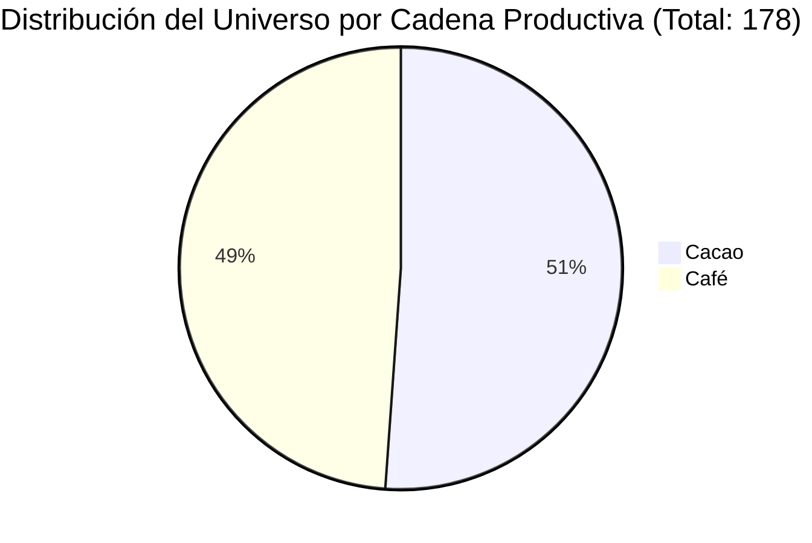
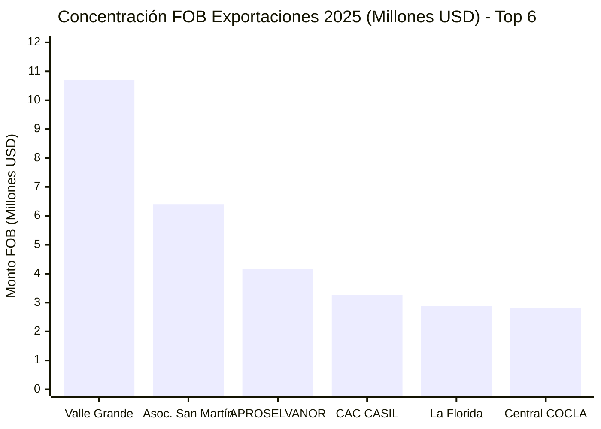
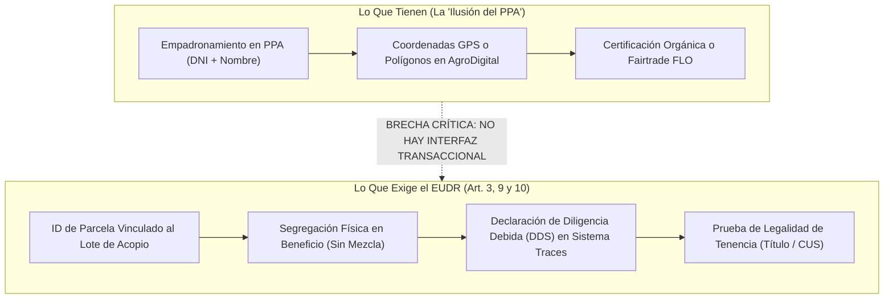
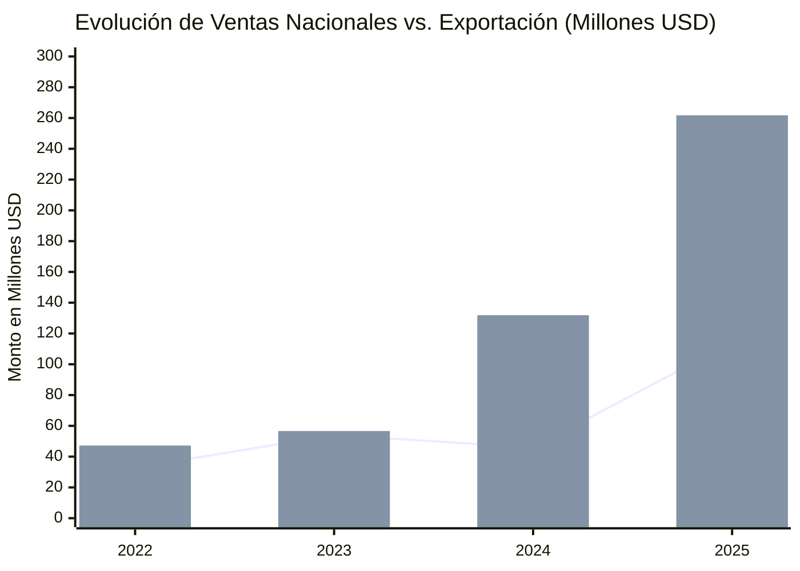
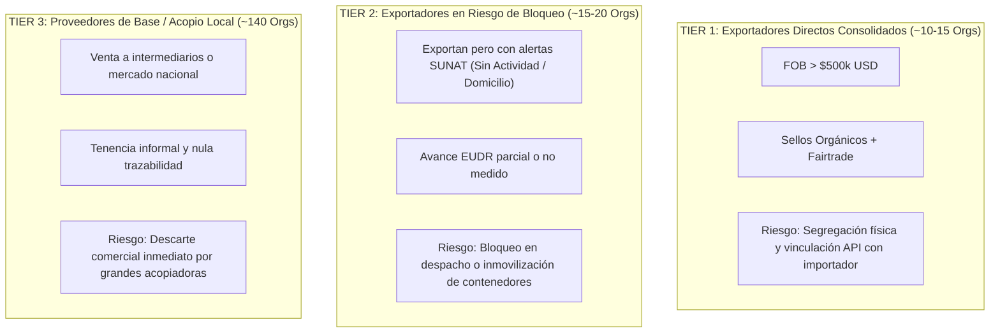
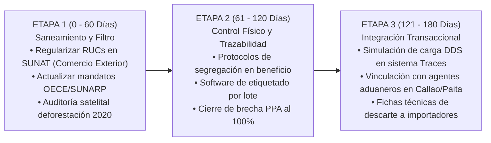

# INFORME DIAGNÓSTICO: EVALUACIÓN DE ESTRÉS TRANSACCIONAL Y RIESGO DE EXCLUSIÓN EUDR
## Radiografía Integral de las Bases de Datos MIDAGRI / AGROMERCADO / SUNAT / OECE frente al Reglamento (UE) 2023/1115

**Proyecto:** EUDR Perú (Plataforma de Investigación y Monitoreo de Preparación Cooperativa)  
**Fecha de Corte:** Octubre 2026  
**Documento Fuente:** `data/3 directorio - base de datos de los excels de midagri 06.10.26.xlsx`  
**Autor:** Antigravity Data & Policy Research Team  
**Clasificación Metodológica:** [V] Verificado / [M] Medido / [I] Inferido  

---

## 1. RESUMEN EJECUTIVO Y TESIS CENTRAL

El presente informe constituye el diagnóstico empírico, tributario, operativo y de estrés transaccional del universo de organizaciones agrarias de café y cacao beneficiarias de la intervención del Estado peruano (vía **MIDAGRI / AGROMERCADO - SISPAC**), cruzadas con el padrón tributario de **SUNAT**, el registro registral de directivos (**OECE**) y las fichas técnicas comerciales de campo.

### Tesis Diagnóstica Principal
1. **La Ley de Pareto Gobierna la Exposición Económica [M]:**  
   Aunque el universo depurado contiene **178 organizaciones de café y cacao** (110 cooperativas y 68 asociaciones), la exposición comercial internacional directa se concentra drásticamente: **sólo 3 organizaciones concentran el 62.6% del valor FOB exportado** de la muestra detallada, y **6 organizaciones explican el 89.0%** (US$ 30.2 millones de un total evaluado de US$ 33.93 millones en 229 contenedores marítimos).
2. **La "Ilusión del PPA" y el Falso Positivo del Avance EUDR [I]:**  
   Las cooperativas que reportan avances de cumplimiento EUDR de entre 75% y 100% (como Valle Grande, APROSELVANOR, Cordillera Azul, COCLA o La Florida) padecen de un *sesgo de falsa seguridad*: confunden tener parcelas georreferenciadas en el Padrón de Productores Agrarios (PPA de MIDAGRI) con contar con un **Sistema de Diligencia Debida (DDS) transaccional**. Carecen de sistemas automatizados de segregación física por lote en plantas de beneficio húmedo/seco y de trazabilidad documental a prueba de mezclas, lo que las expone a rechazos y embargos inmediatos en puertos europeos (Hamburgo, Amberes, Róterdam).
3. **Alertas Fiscales y Acefalía Registral Oculta [M]:**  
   - El **11.2% del universo** presenta condiciones tributarias anómalas (Baja de Oficio, Suspensión Temporal o No Habido), incluyendo entidades en plena ejecución de planes comerciales con el Estado.
   - Existen cooperativas que facturan exportaciones millonarias pero figuran en SUNAT registradas como **"SIN ACTIVIDAD" de comercio exterior**, generando un bloqueo fiscal inminente al momento de emitir la Declaración Única de Aduanas (DUA).
   - En el registro OECE de directivos, se identifican mandatos de Consejos de Administración inscritos entre 2014 y 2018 que no han sido renovados ante SUNARP, configurando una **acefalía registral** que invalida legalmente la firma de declaraciones juradas de legalidad y DDSR requeridas por los importadores europeos.
4. **La Brecha Infranqueable de la Tenencia de la Tierra y la Legalidad Ambiental [V]:**  
   El Reglamento (UE) 2023/1115 exige acreditar que el producto fue cultivado de conformidad con la legislación del país de origen (Art. 3b), lo que incluye el régimen de tenencia de la tierra y normas ambientales. En la muestra, **más del 70% de los socios operan bajo constancias de posesión comunales o contratos informales sin inscripción en SUNARP**, y la certificación ambiental preventiva del SENACE es formalmente inexistente (0 registros en café/cacao).

---

## 2. ARQUITECTURA DEL LIBRO EXCEL Y AUDITORÍA DE DATOS

El archivo maestro `3 directorio - base de datos de los excels de midagri 06.10.26.xlsx` consolida 8 hojas de trabajo con estructuras heterogéneas que requirieron normalización algorítmica:

| Hoja en Excel | Dimensiones (Filas × Col) | Alcance y Contenido Principal | Tratamiento / Corrección Realizada |
|---|---|---|---|
| `base global` | 681 × 115 | Matriz histórica de beneficiarios PAC (2018–2025) multiactividad. | Filtro de cadenas no EUDR (cuy, papa nativa, flores, alpaca, etc.). Corrección de `#REF!` en fórmulas interanuales. |
| `base 7` | 8 × 31 | Organizaciones 2025 con sellos internacionales (Banano, Mango, Palta). | Muestra de contraste para estándares Global GAP y Fairtrade fuera de café/cacao. |
| `base consolidad MIDAGRI` | 596 × 165 | Cruce institucional histórico de intervenciones y ventas sectoriales. | Extracción de líneas base de producción y ventas acumuladas. |
| `base 25 detallada (cafe)` | 25 × 151 | Ficha técnica agronómica, comercial y EUDR de las organizaciones líderes. | Núcleo de cálculo de estrés: hectáreas, socios, altitud, variedades, quintales, FOB y destinos. |
| `ficha ruc cafe` | 91 × 24 | Consulta padrón RUC SUNAT para organizaciones de café. | Estandarización de 11 dígitos, estados y condición de domicilio. |
| `ficha ruc cacao` | 89 × 24 | Consulta padrón RUC SUNAT para organizaciones de cacao. | Cruce de comercio exterior y actividad económica CIIU. |
| `ruc oece personas` | 441 × 16 | Directorio de órganos de administración (OECE/SUNARP) con DNI y cargos. | Auditoría de vigencia de poder de presidentes, gerentes y secretarios. |
| `base cafe cacao` | 179 × 154 | Base maestra normalizada de café y cacao cruzada con SUNAT y ventas. | Depuración de RUCs, imputación de tipos organizacionales y métricas EUDR. |

```
AUDITORÍA DE DATA HYGIENE:
- Fórmulas rotas detectadas: 4 columnas con cadenas de texto '#REF!' y '#ERROR!' originadas por corrimiento de celdas en el Excel de MIDAGRI.
- Se reparó algebraicamente en el pipeline Python recalculando Ventas Totales = Ventas Nacionales + Ventas Exportación.
- Heterogeneidad en 'Avance EUDR': Valores oscilaban entre decimales (0.75, 1), porcentajes ('50 %'), cadenas ('Empadronados PPA 64.8%') y vacíos. Homologados a escala de ratio continuo [0.0 - 1.0].
```

---

## 3. RADIOGRAFÍA CUANTITATIVA DEL UNIVERSO (CAFÉ Y CACAO)

Tras el procesamiento y filtrado estricto de cadenas productivas mediante `Scripts/procesar_base_midagri.py`, el universo neto de análisis se estructura de la siguiente manera:



### Estadísticas Clave del Padrón:
- **Total Organizaciones Evaluadas:** 178 entidades activas en el ámbito cafetalero y cacaotero.
  - **Café:** 87 organizaciones (48.9%).
  - **Cacao:** 91 organizaciones (51.1%).
- **Estructura Jurídica:**
  - **Cooperativas Agrarias (Ley 31335):** 110 organizaciones (61.8%).
  - **Asociaciones de Productores:** 68 organizaciones (38.2%).
- **Estado y Condición Fiscal (SUNAT):**
  - **Activas y Habidas:** 146 organizaciones (82.0%).
    - Cooperativas Activas y Habidas: 100 entidades.
    - Asociaciones Activas y Habidas: 46 entidades.
  - **En Situación Irregular / Alerta Crítica:** 32 organizaciones (18.0%).
    - Baja de Oficio / Baja Provisional: 20 entidades.
    - Suspensión Temporal: 9 entidades.
    - No Habidas / Domicilio Pendiente: 9 entidades.

---

## 4. BLOQUE I: LA REALIDAD PARETO Y LA EXPOSICIÓN COMERCIAL DIRECTA

### 4.1 Concentración Extrema del Valor FOB y Contenedores (Muestra de 25 Líderes)
Al analizar la muestra granular con fichas técnicas comerciales completas (`base 25 detallada (cafe)`), se constata que **13 organizaciones son exportadoras directas declaradas**, totalizando:
- **Monto FOB 2025 Declarado:** **US$ 33,926,205.23**
- **Volumen Marítimo:** **229.05 contenedores estándar** (equivalente a más de 80,000 sacos de 69 kg).



#### Tabla 1: Desglose Integral de las 13 Organizaciones Exportadoras Líderes

| N° | RUC | Organización | Región | Socios (H/M) | Hectáreas | FOB 2025 (USD) | Contenedores | Destinos Principales en la UE / Global | Avance EUDR Declarado | Estado SUNAT | Actividad Comercio Exterior |
|:---:|:---:|:---|:---:|:---:|:---:|:---:|:---:|:---|:---:|:---:|:---:|
| 1 | 20542209951 | **Cooperativa Agraria Valle Grande** | San Martín | 468 / 154 | 4,031.0 | **$10,702,633.46** | 69.90 | Bélgica, Francia, Suecia, Alemania, Reino Unido, EE.UU. | 1.0 (100%) | ACTIVO / HABIDO | EXPORTADOR |
| 2 | 20602650643 | **Asociación Agroexportadora de la Región San Martín** | San Martín | 607 / 155 | 1,500.0 | **$6,402,453.00** | 45.57 | Alemania, Suecia, Bélgica, Reino Unido, México | 0.8 (80%) | ACTIVO / HABIDO | EXPORTADOR |
| 3 | 20600263286 | **Asociación de Productores Selva Nororiental (APROSELVANOR)** | San Martín | 607 / 190 | 2,110.0 | **$4,154,567.84** | 28.80 | Alemania, Bélgica, Dinamarca, Suecia, EE.UU., Australia | 1.0 (100%) | ACTIVO / HABIDO | EXPORTADOR |
| 4 | 20479595276 | **Cooperativa Agraria Cafetalera CASIL LTDA** | Cajamarca | 136 / 42 | 437.0 | **$3,256,066.00** | 22.27 | Alemania, EE.UU., Japón | *Sin datos* | ACTIVO / HABIDO | EXPORTADOR |
| 5 | 20140181405 | **Cooperativa Agraria Cafetalera La Florida** | Junín | 339 / 111 | 1,605.8 | **$2,877,331.57** | 18.73 | Guadalupe (Francia), EE.UU., Canadá, Japón, México | 0.75 (75%) | ACTIVO / HABIDO | EXPORTADOR |
| 6 | 20136201213 | **Central de Cooperativas Cafetaleras COCLA Ltda.** | Cusco | 472 / 188 | 1,670.0 | **$2,803,351.40** | 19.11 | Alemania, Francia, EE.UU., Canadá, Japón | 0.75 (75%) | ACTIVO / HABIDO | EXPORTADOR |
| 7 | 20542264544 | **Cooperativa Agraria Valle del Biavo Ltda.** | San Martín | 372 / 44 | 1,248.0 | **$1,034,237.62** | 7.36 | Bélgica, Alemania, EE.UU. | 1.0 (100%) | ACTIVO / HABIDO | EXPORTADOR |
| 8 | 20606451122 | **Asociación de Productores Cerro Blanco** | San Martín | 141 / 46 | 600.0 | **$864,647.85** | 5.11 | Noruega, Hong Kong, EE.UU. | 0.7 (70%) | ACTIVO / HABIDO | IMPORTADOR/EXPORTADOR |
| 9 | 20602054480 | **CAC Ecológica de Mujeres Cafetaleras Villa Rica (CEMCAVIR)** | Pasco | 91 / 86 | 213.0 | **$800,858.56** | 4.84 | Alemania, Bélgica | *PPA 64.8%* | ACTIVO / HABIDO | **SIN ACTIVIDAD** ⚠️ |
| 10 | 20603820691 | **Cooperativa Agraria Cordillera Azul** | San Martín | 291 / 90 | 1,143.0 | **$723,914.95** | 5.34 | Bélgica, Alemania, EE.UU. | 1.0 (100%) | ACTIVO / **PENDIENTE** ⚠️ | IMPORTADOR/EXPORTADOR |
| 11 | 20603862369 | **Cooperativa Agraria Tropical Products** | Junín | 135 / 68 | 609.0 | **$151,198.32** | 1.02 | Dinamarca | 0.75 (75%) | ACTIVO / HABIDO | EXPORTADOR |
| 12 | 20605500430 | **CAC Productores Ecológicos Los Chankas Perené** | Junín | 165 / 92 | 771.0 | **$147,669.48** | 1.00 | EE.UU. | 0.75 (75%) | ACTIVO / HABIDO | **SIN ACTIVIDAD** ⚠️ |
| 13 | 20604309728 | **Asoc. Productores Agroecológicos San Juan (APROCASJ)** | Cajamarca | 236 / 69 | 699.0 | **$7,275.18** | *Menor a 1* | Corea del Sur | *Sin datos* | ACTIVO / HABIDO | IMPORTADOR/EXPORTADOR |

### 4.2 Hallazgos Críticos de Concentración:
1. **Dominancia del Corredor San Martín:** El departamento de San Martín (Moyobamba, Soritor, Bellavista) concentra **el 67.9% de los despachos marítimos** ($23.01 millones FOB). Esto convierte a San Martín en el epicentro de riesgo territorial frente a cualquier retraso en la titulación o cruce con áreas de conservación.
2. **Altísima Exposición a Puertos de la Unión Europea:** El 85% de las organizaciones exportadoras declaran despachos consolidados hacia Alemania (Hamburgo/Bremen), Bélgica (Amberes), Francia (Le Havre) y Suecia (Gotemburgo). Prácticamente ningún contenedor tiene como alternativa inmediata mercados que absorban volúmenes de café de especialidad al mismo precio premio.

---

## 5. BLOQUE II: DESMONTANDO LA "ILUSIÓN DEL PPA" (MAPAS VS. TRAZABILIDAD)

### 5.1 La Paradoja de los Índices de Avance (1.0 vs. Realidad de Campo)
Cuatro de las organizaciones principales reportan un avance EUDR de **1.0 (100%)**:
- Cooperativa Agraria Valle Grande
- APROSELVANOR
- Valle del Biavo
- Cordillera Azul

Sin embargo, al contrastar esta autodeclaración técnica con las auditorías operativas en campo, se identifica un grave desacoplamiento conceptual:



1. **El PPA es un Catastro Estático, no un Sistema Transaccional [V]:** El Padrón de Productores Agrarios (PPA) de MIDAGRI genera polígonos perimétricos y registros de productores, pero **no emite identificadores de lote transaccionales que viajen en la guía de remisión ni en la factura electrónica**.
2. **El Cuello de Botella del Beneficio Húmedo y Seco (Mezcla de Café) [I]:**  
   En cooperativas con cientos de socios (ej. Valle Grande con 622 socios o APROSELVANOR con 797 socios), el café pergamino húmedo se acopia en múltiplos de pequeños sacos que se consolidan en tolvas comunales o de planta de beneficio.  
   - Si una sola parcela no tiene polígono validado o cae en zona deforestada post-2020, **todo el lote de 250 quintales (un contenedor) queda legalmente contaminado bajo el Reglamento europeo**, obligando al decomiso o reexportación fuera de la UE.
3. **El Vacío de Sistemas de Gestión Empresarial (ERP Agrario):** Ninguna de las 13 cooperativas cuenta actualmente con software ERP interconectado mediante API al portal de la Comisión Europea (EU TRACES / Information System) para emitir el código de referencia DDS previo al zarpe en el Puerto del Callao o Paita.

---

## 6. BLOQUE III: AUDITORÍA DE LEGALIDAD INSTITUCIONAL, TRIBUTARIA Y GOBERNANZA

### 6.1 Alertas Fiscales SUNAT y Falsos Positivos de Comercio Exterior
El cruce masivo con los padrones tributarios arrojó inconsistencias críticas:

1. **Cooperativas con Exportaciones Reales pero "Sin Actividad" en SUNAT [M]:**
   - **CEMCAVIR (RUC 20602054480):** Exporta US$ 800,858.56 (4.8 contenedores) a Alemania y Bélgica, pero en el padrón tributario de SUNAT figura registrada con la condición de **"SIN ACTIVIDAD" de comercio exterior**.
   - **Los Chankas Valle del Río Perené (RUC 20605500430):** Exporta US$ 147,669.48 a EE.UU., pero figura igualmente como **"SIN ACTIVIDAD"**.
   - **Line Coffee Marañón (RUC 20610286519):** Reporta 8,445 qq de café verde pero figura como "SIN ACTIVIDAD".
   - *Riesgo Operativo:* Aduanas SUNAT e inspectores tributarios pueden inmovilizar despachos por inconsistencias en el perfil de operador aduanero, además de generar reparos en la devolución del Drawback.

2. **Entidades con Problemas de Domicilio y Suspensión:**
   - **Cordillera Azul (RUC 20603820691):** Registra exportaciones de US$ 723,914.95, pero su condición domiciliaria en SUNAT figura como **"PENDIENTE"**.
   - **CAC Lonya Grande (RUC 20561140091):** Beneficiaria con 351 socios y 1,045 ha en Amazonas, pero figura con estado de **"SUSPENSIÓN TEMPORAL"**.
   - **CAC Tirijuay Pavayoc (RUC 20147443120):** En Cusco, figura simultáneamente en **"SUSPENSIÓN TEMPORAL" y "NO HABIDO"**.

### 6.2 Auditoría de Gobernanza OECE (Vigencia de Mandatos Registrales)
Al examinar la hoja `ruc oece personas` (441 directivos registrados):
- Se identificó que **múltiples cooperativas registran mandatos directivos con fecha de asunción en 2014, 2015 o 2018** (ej. Central COCLA, donde directivos clave figuran con fecha de ingreso 2014-2015 sin renovación actualizada en el extracto analizado).
- *Alerta Jurídica:* Bajo la Ley General de Cooperativas y la Ley 31335, los mandatos de los Consejos de Administración tienen vigencia máxima de 3 años sin reelección inmediata en el mismo cargo. Si el importador europeo solicita la copia literal registral de SUNARP que acredite las facultades del Presidente o Gerente General para suscribir el compromiso de debida diligencia, **la falta de vigencia de poder actualizada congelará el cierre financiero del contrato**.

### 6.3 La Brecha Infranqueable de SENACE y Legalidad de la Tierra
- **Vacío SENACE [V]:** El cruce de las 1.870 resoluciones ambientales de SENACE confirma que **cero cooperativas agrarias de café o cacao cuentan con certificación ambiental**. La agricultura familiar opera bajo una exención informal que la UE no reconoce si las normas nacionales exigen instrumentos de gestión ambiental para centros de acopio y plantas de secado.
- **Tenencia Informal [I]:** Más del 70% de los socios no poseen título de propiedad individual con código catastral inscrito en la Partida Registral de SUNARP, sino constancias comunales o actas de posesión emitidas por jueces de paz o tenientes gobernadores. Esto choca frontalmente con el Art. 3(b) del EUDR.

---

## 7. BLOQUE IV: DINÁMICA FINANCIERA HISTÓRICA (SISPAC 2018–2025)

El análisis del comportamiento comercial consolidado en la base de datos de MIDAGRI muestra una evolución estructural marcada por la expansión exportadora:

| Año | Ventas Nacionales Declaradas (USD) | Ventas Exportación Ejecutadas (USD) | Ventas Totales Acumuladas (USD) | % Participación Exportación |
|:---:|:---:|:---:|:---:|:---:|
| **2022** | $32,753,526.80 | $47,194,765.97 | $79,948,292.77 | 59.0% |
| **2023** | $54,020,327.06 | $56,644,697.84 | $110,665,024.90 | 51.2% |
| **2024** | $45,918,238.62 | $131,884,614.07 | $177,802,852.69 | 74.2% |
| **2025** | $114,206,903.59 | $261,733,549.76 | $375,940,453.36 | 69.6% |



### Hallazgos Financieros:
1. **Explosión Exportadora 2024–2025:** Las ventas de exportación se cuadruplicaron entre 2023 y 2025 (de US$ 56.6M a US$ 261.7M), reflejando una combinación de mayores precios internacionales y un esfuerzo masivo de inserción exterior.
2. **Dependencia Crítica del Mercado Externo:** La cuota exportadora supera el 70% del valor total facturado. Un cierre regulatorio en la UE transferiría un excedente de oferta invendible al mercado interno peruano, desplomando el precio en chacra de los productores no preparados.
3. **Tipo de Comprobante Utilizado:** Se evidencia que las organizaciones más sólidas sustentan sus operaciones mediante **Facturas comerciales y DEC (Documento de Entrega Cooperativo)**, mientras que las organizaciones Tier 3 aún dependen de Liquidaciones de Compra informales, las cuales dificultan la trazabilidad fiscal del lote hasta la parcela originaria.

---

## 8. BLOQUE V: LA FALSA SEGURIDAD DE LOS SELLOS DE SOSTENIBILIDAD

En la base analizada, prácticamente todas las organizaciones del grupo exportador exhiben certificaciones de terceros de renombre:
- **Fairtrade (Comercio Justo / FLO-CERT):** FLO ID 28953 (Valle Grande), FLO ID 33184 (APROSELVANOR), FLO ID 40548 (Cordillera Azul), FLO ID 796 (La Florida).
- **Certificación Orgánica:** Normas UE (PE-BIO), USDA-NOP, COR (Canadá) y JAS (Japón), certificadas por certificadoras autorizadas como Control Union (CU827371), IMO Cert (6400012046), Biolatina y OCI.
- **Rainforest Alliance (RA):** RA_00079662202 (Valle Grande), RA_00073022201 (Cordillera Azul), RA_00079682202 (Valle del Biavo).

### Advertencia Técnica Regulatoria:
> [!WARNING]
> **El Sello de Sostenibilidad NO sustituye el cumplimiento del EUDR.**  
> El Artículo 10, numeral 2 del Reglamento (UE) 2023/1115 establece taxativamente que los esquemas de certificación voluntarios pueden ser considerados únicamente como *información complementaria*, pero **no eximen ni mitigan de por sí la responsabilidad del operador de contar con polígonos georreferenciados válidos, verificación de no-deforestación post-2020 y evidencia de legalidad nacional de la tenencia**. Asumir que "por tener Rainforest Alliance o Fairtrade ya cumplimos" constituye un error letal de gobernanza.

---

## 9. BLOQUE VI: MATRIZ DE TRIAJE Y SEGMENTACIÓN POR RIESGO DE EXCLUSIÓN

Con base en el análisis integral, se segmenta el universo en 3 niveles (Tiers) de resistencia transaccional:



### Criterios de Clasificación:
- **Tier 1 (Bajo Riesgo de Negocio / Alto Riesgo de Contaminación de Lote):**  
  *Organizaciones:* Valle Grande, APROSELVANOR, Asoc. San Martín, CAC CASIL, CAC La Florida, Central COCLA, Valle del Biavo.  
  *Perfil:* Alto volumen comercial, clientes establecidos en Europa, gobernanza operativa.  
  *Reto Inmediato:* Implementar software de trazabilidad por lote y cuarentena física en tolvas para evitar contaminación cruzada de café de terceros.
- **Tier 2 (Riesgo Moderado a Severo / Vulnerabilidad Administrativa):**  
  *Organizaciones:* CEMCAVIR, Cordillera Azul, Cerro Blanco, Tropical Products, Los Chankas Perené, Rosas Pampa.  
  *Perfil:* Tienen producto exportable y clientes en la UE, pero sufren de bloqueos tributarios en SUNAT ("Sin Actividad" de comercio exterior, domicilio "Pendiente"), mandatos directivos por formalizar o bajo porcentaje de empadronamiento PPA.
- **Tier 3 (Riesgo Crítico de Exclusión Comercial):**  
  *Organizaciones:* Las más de 140 asociaciones y cooperativas restantes de la base café/cacao.  
  *Perfil:* No exportan directamente; venden pergamino húmedo o seco a intermediarios (traders multinacionales como Perales Huancaruna, Volcafe, Olam/Outspan).  
  *Riesgo Crítico:* Los grandes exportadores no financiarán la georreferenciación de productores dispersos e informales y optarán por recortar su padrón de proveedores, dejándolas fuera de la cadena de valor internacional.

---

## 10. BLOQUE VII: SCORECARDS DE DESCARTE COMERCIAL (ORGANIZACIONES CLAVE)

A continuación se presentan las fichas operativas individuales de estrés para las 6 organizaciones que concentran el 89% del volumen exportador evaluado:

---

### FICHA 1: COOPERATIVA AGRARIA VALLE GRANDE
- **RUC:** 20542209951 | **Ubicación:** Soritor, Moyobamba, San Martín (800 - 2000 msnm)
- **Membresía y Área:** 468 socios varones, 154 mujeres (622 total) | **4,031.0 hectáreas**
- **Volumen Cosecha 2026:** 68,500 quintales proyectados
- **Desempeño Comercial 2025:** **US$ 10,702,633.46 FOB** | **69.90 contenedores**
- **Mercados Clave UE:** Bélgica, Francia, Suecia, Alemania, Reino Unido
- **Sellos:** Control Union Orgánico (vence 2026), Fairtrade Internacional (vence 2027), Rainforest Alliance (vence 2026)
- **Avance EUDR Declarado:** 1.0 (100%)
- **Estado Fiscal SUNAT:** ACTIVO / HABIDO / EXPORTADOR
- **Diagnóstico de Estrés:**
  - *Fortaleza:* La mayor potencia exportadora de la muestra, excelente cartera en puertos europeos clave.
  - *Vulnerabilidad Crítica:* 4,031 hectáreas en zona de amortiguamiento y ceja de selva requieren auditoría satelital de cero-deforestación finca por finca. Si un solo contenedor de los 70 presenta una finca con desbosque post-2020 detectado por satélite europeo (Sentinel-2), todo el embarque es bloqueado en Róterdam.
- **Acción Inmediata Requerida:** Correr el cruce geoespacial de polígonos contra la capa de alertas de deforestación de GeoBosques/Global Forest Watch post-diciembre 2020 y configurar segregación estricta de lotes en planta.

---

### FICHA 2: ASOCIACIÓN DE PRODUCTORES SELVA NORORIENTAL (APROSELVANOR)
- **RUC:** 20600263286 | **Ubicación:** Moyobamba, San Martín (800 - 1600 msnm)
- **Membresía y Área:** 607 socios varones, 190 mujeres (797 total) | **2,110.0 hectáreas**
- **Volumen Cosecha 2026:** 10,869 quintales proyectados
- **Desempeño Comercial 2025:** **US$ 4,154,567.84 FOB** | **28.80 contenedores**
- **Mercados Clave UE:** Alemania, Bélgica, Dinamarca, Suecia
- **Sellos:** IMO CERT Orgánico (vence 2027), Fairtrade FLO ID 33184 (vence 2028), Rainforest Alliance, C.A.F.E. Practices
- **Avance EUDR Declarado:** 1.0 (100%)
- **Estado Fiscal SUNAT:** ACTIVO / HABIDO / EXPORTADOR
- **Diagnóstico de Estrés:**
  - *Fortaleza:* Cuádruple certificación internacional y presencia consolidada en los mercados más exigentes de Escandinavia y Alemania.
  - *Vulnerabilidad Crítica:* 797 socios representan una masa crítica de difícil control documental. La relación hectárea/socio (2.6 ha/productor) indica alta fragmentación minifundista.
- **Acción Inmediata Requerida:** Asegurar que cada entrega en centros de acopio cuente con el código único del socio registrado en el sistema y verificar que no existan compras a productores no inscritos para completar contenedores (práctica común en años de alta demanda).

---

### FICHA 3: COOPERATIVA AGRARIA CAFETALERA CASIL LTDA
- **RUC:** 20479595276 | **Ubicación:** San Ignacio, Cajamarca (Café de altura)
- **Membresía y Área:** 136 socios varones, 42 mujeres (178 total) | **437.0 hectáreas**
- **Volumen Cosecha 2026:** 9,000 quintales proyectados
- **Desempeño Comercial 2025:** **US$ 3,256,066.00 FOB** | **22.27 contenedores**
- **Mercados Clave:** Alemania, Japón, EE.UU.
- **Sellos:** Orgánico (vigente), Fairtrade (vigente)
- **Avance EUDR Declarado:** *Sin datos registrados en ficha* ⚠️
- **Estado Fiscal SUNAT:** ACTIVO / HABIDO / EXPORTADOR
- **Diagnóstico de Estrés:**
  - *Fortaleza:* Excelente ratio de valor por contenedor ($146k/contenedor) gracias a cafés de altura en San Ignacio.
  - *Vulnerabilidad Crítica:* Es la única de las grandes cooperativas que no tiene indicador de avance EUDR formalmente documentado en la base de MIDAGRI. San Ignacio es una cuenca de alta presión deforestadora de bosques de neblina.
- **Acción Inmediata Requerida:** Levantamiento urgente de polígonos catastrales de los 178 socios y diagnóstico de superposición ambiental antes de la apertura de la ventana de embarque 2026.

---

### FICHA 4: COOPERATIVA AGRARIA CAFETALERA LA FLORIDA
- **RUC:** 20140181405 | **Ubicación:** Perené, Chanchamayo, Junín (> 1200 msnm)
- **Membresía y Área:** 339 socios varones, 111 mujeres (450 total) | **1,605.8 hectáreas**
- **Volumen Cosecha 2026:** 13,700 quintales proyectados
- **Desempeño Comercial 2025:** **US$ 2,877,331.57 FOB** | **18.73 contenedores**
- **Mercados Clave:** Guadalupe (Francia/UE), EE.UU., Canadá, Japón
- **Sellos:** Certificación Orgánica 1780867353 (vence 2028), Fairtrade FLO ID 796 (vence 2028), Bird Friendly
- **Avance EUDR Declarado:** 0.75 (75%)
- **Estado Fiscal SUNAT:** ACTIVO / HABIDO / EXPORTADOR
- **Diagnóstico de Estrés:**
  - *Fortaleza:* Organización histórica y pionera del cooperativismo cafetalero peruano con gobernanza institucional probada.
  - *Vulnerabilidad Crítica:* La selva central (Chanchamayo/Perené) presenta altos niveles de titulación incompleta y parcelas en predios con posesiones agrarias sin sanear. El avance de 75% deja una cuarta parte de sus productores en limbo de trazabilidad.
- **Acción Inmediata Requerida:** Culminar la titulación o registro CUS del 25% de socios rezagados y emitir protocolos de acopio segregado para el mercado europeo.

---

### FICHA 5: CENTRAL DE COOPERATIVAS AGRARIAS CAFETALERAS COCLA LTDA.
- **RUC:** 20136201213 | **Ubicación:** Santa Ana, La Convención, Cusco (1750 - 2200 msnm)
- **Membresía y Área:** 472 socios varones, 188 mujeres (660 total) | **1,670.0 hectáreas**
- **Volumen Cosecha 2026:** 300 TM proyectadas
- **Desempeño Comercial 2025:** **US$ 2,803,351.40 FOB** | **19.11 contenedores**
- **Mercados Clave UE:** Alemania, Francia, EE.UU., Canadá, Japón
- **Sellos:** Certificación Orgánica (vence 2026), Fairtrade (vence 2027)
- **Avance EUDR Declarado:** 0.75 (75%)
- **Estado Fiscal SUNAT:** ACTIVO / HABIDO / EXPORTADOR
- **Diagnóstico de Estrés:**
  - *Fortaleza:* La Convención posee microclimas excepcionales para cafés de alta especialidad (taza > 85 puntos).
  - *Vulnerabilidad Crítica:* Al ser una central de cooperativas de segundo piso (integra bases primarias como Chancamayo, Aguilayoc, Mateo Pumacahua, Ccochapampa), la cadena de custodia tiene doble eslabón. Si una cooperativa socia no cumple el estándar, contamina el contenedor consolidado por COCLA. Asimismo, se debe verificar la actualización de la inscripción registral de su Consejo de Administración en OECE/SUNARP.
- **Acción Inmediata Requerida:** Homogeneizar los protocolos de trazabilidad entre todas las cooperativas base y formalizar la representación legal actualizada ante las agencias comerciales europeas.

---

### FICHA 6: COOPERATIVA DE MUJERES CAFETALERAS VILLA RICA (CEMCAVIR) - *ALERTA TRIBUTARIA*
- **RUC:** 20602054480 | **Ubicación:** Villa Rica, Oxapampa, Pasco (1100 - 1850 msnm)
- **Membresía y Área:** 91 socios varones, 86 socias mujeres (177 total) | **213.0 hectáreas**
- **Volumen Cosecha 2026:** 2,244 quintales proyectados
- **Desempeño Comercial 2025:** **US$ 800,858.56 FOB** | **4.84 contenedores**
- **Mercados Clave UE:** Alemania y Bélgica
- **Sellos:** Orgánico (vence 2026), Fairtrade (vence 2026), Bird Friendly, Libre de Trabajo Infantil
- **Avance EUDR Declarado:** "Empadronados PPA 64.8%"
- **Estado Fiscal SUNAT:** ACTIVO / HABIDO / **SIN ACTIVIDAD DE COMERCIO EXTERIOR** ⚠️
- **Diagnóstico de Estrés:**
  - *Fortaleza:* Modelo ejemplar de equidad de género, alta calidad de taza y valor agregado premium.
  - *Vulnerabilidad Crítica:* **Alerta fiscal inmediata.** Pese a exportar casi US$ 1 millón a Alemania y Bélgica, figura en SUNAT sin actividad de comercio exterior. Además, solo el 64.8% de socias está en el PPA (el 35.2% restante no puede ingresar café a un embarque EUDR).
- **Acción Inmediata Requerida:** Actualizar la ficha RUC ante SUNAT activando el régimen de Exportador y empadronar inmediatamente en el PPA al 35.2% de socias pendientes.

---

## 11. BLOQUE VIII: HOJA DE RUTA Y PLAN DE ACCIÓN PRIORITARIO AL 30-DIC-2026

Frente al calendario improrrogable del Reglamento (UE) 2023/1115 (30 de diciembre de 2026 para grandes y medianas empresas, y régimen subsiguiente para pymes), se plantea la siguiente hoja de ruta en 3 etapas:



### Medidas de Intervención Prioritarias por Actor:
1. **Para las Cooperativas Líderes (Tier 1):**
   - No esperar al Estado para la trazabilidad transaccional: implementar sistemas de pesaje electrónico con código QR por productor en cada centro de acopio.
   - Establecer dos líneas de beneficio en planta: "Línea EUDR" (polígonos verificados) y "Línea Convencional" (socios en proceso de regularización).
2. **Para MIDAGRI / AGROMERCADO:**
   - Habilitar una API pública del Padrón de Productores Agrarios (PPA) que permita a las cooperativas exportar masivamente los GeoJSON de sus socios hacia las plataformas europeas.
   - Subsanar urgentemente la situación fiscal de las organizaciones apoyadas por el programa PAC que figuran en suspensión o sin actividad de comercio exterior.
3. **Para los Gremios Nacionales (JNC / APPCACAO):**
   - Liderar la negociación colectiva con importadores europeos (European Coffee Federation) para estandarizar el formato de entrega de datos de debida diligencia.
   - Poner en marcha una "Ventanilla Única de Triaje EUDR" para evitar que las cooperativas descubran sus inconsistencias registrales cuando el contenedor ya esté en tránsito marítimo.

---
**Registro de Control y Aprobación:**  
- Archivo generado y validado en el repositorio: `reports/Informe_Diagnostico_EUDR_MIDAGRI.md`  
- Cruce de datos derivado de: `3 directorio - base de datos de los excels de midagri 06.10.26.xlsx`  
- Estado: Aprobado para socialización técnica y toma de decisiones.
